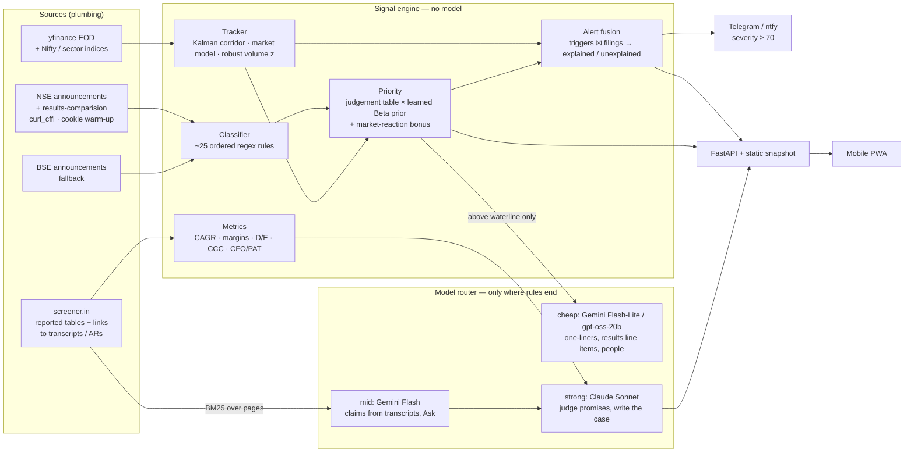

# FINN — a filter, not a feed

A mobile-first investment agent built for the ENAM AI Engineer Build Challenge.
**Push** tells you what changed and why you should care. **Pull** digs into any NSE company,
using only what management itself filed and said.

> **One idea runs through the build:** the scarce resource is the investor's attention.
> Every screen is a filter with a visible control:
> - a **waterline** you drag to set the noise floor;
> - **thresholds** you set yourself, with a live count of how many alerts they would have fired;
> - a **say–do score** that tells you how far to trust the next thing management promises.

---

## 60-second tour

| Screen | What it does | The judgement inside |
|---|---|---|
| **Today** | A one-sentence brief (you can have it read aloud), then **Needs you** (alerts), then the **filings digest** for the window you pick. | Alerts are ranked so that **unexplained moves come first**. That means a stock-specific move with *no filing* on that day or the day before. A move with no disclosure behind it is the one an investor most needs to know about. |
| **Waterline** | Filings above the line are shown with a one-line summary, a results grid or a person card. Everything below sinks into collapsed category counts. | Each filing gets a 0–100 score with a plain-English reason ("Management · CXO/MD exit · stock moved −6.1%, −4.2σ stock-specific"). Swipe right to keep, left to bury, and FINN learns per-category weights. |
| **Results card** | Revenue / EBITDA / PBT / PAT, QoQ and YoY, plus the margin change in bps. | Headline numbers come from NSE's own XBRL-parsed comparison first, which is free and exact. A model is used only to *read* line items from the PDF when that isn't available. **Code computes EBITDA and every delta.** |
| **Management card** | Who is coming in and where they came from. | First source is the filing itself, because SEBI LODR Reg 30 requires a "brief profile" for appointments. Web-search snippets (LinkedIn and company pages) add to it. LinkedIn is never scraped. |
| **Portfolio** | Holdings sorted by **how unusual today was for that stock**, each with its Kalman "corridor". | The σ figure is the market-model residual, so a stock falling 4% on a −3% Nifty day stays quiet. |
| **Research** | **Promise Ledger** (guidance vs delivery over the last 4 concalls) → Narrative vs Numbers → Bull/Bear → Numbers → Ask (with voice input). | Grounded only in annual reports and transcripts. Every line must cite `[T2 p.4]`, `[AR26 p.88]` or `[NUMBERS]`, and **a validator drops lines whose citation doesn't exist**. Ratios are computed in code. |
| **Tune** | Price %, volume ×, stock-specific σ and corridor σ sliders, plus which filing types may interrupt you. Also shows what FINN has learned and what it has cost so far. | The alert count updates as you drag. Interrupts follow only explicit rules; anything learned changes the digest order, never the alerts. |

## Architecture



**Model routing.** The order of preference is: rules, then arithmetic, then a cheap model, then a strong model.
- **Rules:** about 90% of filings are classified by regex.
- **Arithmetic:** NSE's parsed numbers and every ratio are computed in code.
- **Cheap model:** used only for items above the waterline.
- **Strong model:** used only for the two steps that need reasoning, judging promises and writing the case.

Every model call is content-hash cached and logged to a cost ledger, which the app shows on Tune.

**Estimated cost:** about $0.11 (₹10) for a full research pack, cached for 24 hours, and around a cent a day for the push side. With no API keys at all, FINN still runs everything that is rules plus arithmetic.

More detail: [docs/ARCHITECTURE.md](docs/ARCHITECTURE.md) · research behind the choices: [docs/RESEARCH.md](docs/RESEARCH.md)

## Run it

```bash
make setup                 # pip + npm
make demo                  # synthetic, clearly-labelled FICTIONAL companies, run through the real engine
make dev                   # API on :8000, app on :5173

# real data (needs a normal internet connection)
cp .env.example .env       # add a free GEMINI_API_KEY at minimum; ANTHROPIC_API_KEY for the strong tier
make doctor                # checks yfinance / NSE / BSE / screener / model keys from YOUR network
make run                   # prices → filings → alerts → push
make export                # writes frontend/public/data/*.json — the snapshot the deployed PWA reads
cd backend && python -m finn research ASIANPAINT    # pull research on ANY NSE symbol
make test                  # 21 offline tests (classifier, scorer, tracker calibration, parser, research e2e)
```

**Deploy.** There are two options, described in [docs/DEPLOY.md](docs/DEPLOY.md):
- a static PWA on Vercel or Netlify that reads the snapshot, so it never goes down;
- the full app (API + PWA in one container) on Render's free tier, which adds live research on any ticker.

A GitHub Action runs the after-close job on weekdays at 16:20 IST and commits a fresh snapshot.

## Repo map

```
backend/finn/
  sources/   prices.py · nse.py · bse.py · screener.py · pdftext.py      ← plumbing
  engine/    tracker.py (Kalman + market model) · classify.py · priority.py
             enrich.py (results / people / one-liners) · metrics.py · research.py (ledger, synthesis, ask)
  llm/       router.py  (tiers, fallbacks, cache, cost ledger)
  pipeline.py · notify.py · export.py · api.py · demo.py · __main__.py (CLI)
frontend/src/
  screens/   Today · Holdings · Research · Tune
  components/ Corridor (Kalman band) · Waterline · Swipe/Sheet/ResultsGrid/People
  lib/       engine.ts (client mirror of alert rules → live threshold tuning) · data.ts (live ⇄ snapshot)
docs/        ARCHITECTURE · RESEARCH · DEPLOY · COVERING_EMAIL · BUILD_LOG
```

## Deliberately left out
- **Intraday data.** The brief is end-of-day, and intraday adds cost and noise before it adds signal.
- **Broker notes, news and sentiment.** The pull side is primary-sources-only by design.
- **Price targets and buy/sell calls.** FINN filters and analyses; the investor decides.
- **Logins and multi-user support.** This is one investor's tool, so preferences live on the device.
- **Embeddings and a vector DB.** BM25 over page-level chunks is enough for four transcripts plus one annual report, and it costs nothing.

## Where I'd take it next
1. Score the Promise Ledger across the whole portfolio, so new guidance from low say–do managements is automatically discounted in the digest.
2. Calibrate the priority table on history: label 2 years of filings by their next-day abnormal return, then fit the weights (the event-study setup already exists in `tracker.py`).
3. Transcribe concall audio on the day of the call (Whisper), instead of waiting up to 5 working days for the transcript.
4. Add a contagion view: when one holding has an unexplained move, flag its most correlated peers in the portfolio.
